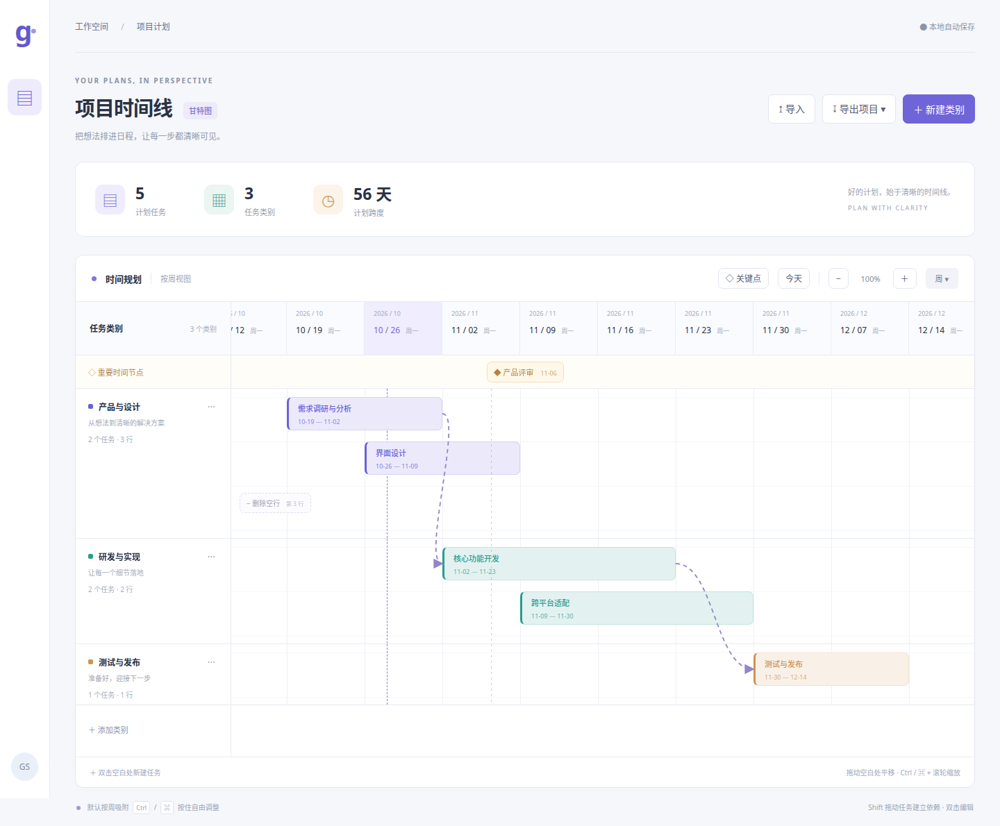

# Gantt Studio

一个支持 Windows、macOS 和 Linux 的本地甘特图规划软件。使用 Electron + Vite + 原生 JavaScript，无账号、无服务端，项目数据保存在当前设备。



## 开发与运行

需要 Node.js **22.12 或更高版本**（推荐 Node.js 24 LTS）。

```bash
npm ci
npm run dev      # 浏览器开发预览
npm run desktop  # 构建并打开桌面应用
```

## 使用方式

- 时间轴默认按周显示，每周从周一开始，表头显示年份、月份和日期。拖动空白区域或横向滚动可平移。
- 点击 `＋` / `−`，或按住 Ctrl / Command 滚轮缩放；“今天”返回当前日期。
- 双击类别的空白时间网格新建任务；双击圆角任务块编辑名称、内容及起止时间。
- 拖动任务本体移动任务，可移动到其他类别；拖动左右边框修改开始或结束时间。
- 默认吸附到最近的周一。按住 **Ctrl（Windows / Linux）或 Command（macOS）** 可自由调整至分钟精度。
- 重叠采用半开区间 `[开始, 结束)` 判断；结束时间与下一任务开始时间相同不算重叠。
- 放下任务时若目标行已有重叠任务，会在目标行下方插入新行；拖到类别顶部或底部的提示带并释放，会插入新行。
- 点击“新建类别”或左下“添加类别”设置类别名称和说明；类别右侧 `···` 可修改、删除。
- 点击顶部“◇ 关键点”添加重要时间节点，也可双击关键点时间带创建。拖动节点改变时间，默认按周吸附，Ctrl / Command 可精细调整；单击节点编辑名称、时间或删除。
- 按住 **Shift** 从前置任务拖到后续任务，释放建立“完成后开始”依赖，以带箭头的贝塞尔虚线表示。支持多级依赖，阻止自连接、重复连接及循环依赖。
- 调整任务起止时间或移动任务时，后续任务同步联动，保留原有间隔和持续时长；多个前置任务取最晚约束。直接将后项移到前项结束之前时自动限制。双击任务可查看、解除依赖；删除任务或类别自动清理关联连线。
- 空行在网格左侧直接显示“− 删除空行”按钮，点击即可删除并上移后续行；有任务的行不能删除，每个类别至少保留一行。此操作不改变任务时间或依赖。
- 顶部“导出项目”下拉菜单可直接选择 **JSON / PNG / SVG**，无需弹窗。JSON 用于可编辑备份和跨设备迁移；PNG/SVG 输出完整项目（含关键点、依赖和类别），不受当前缩放、滚动位置影响。PNG 普通项目按 2 倍分辨率输出，超大项目自动降低倍率，建议使用 SVG 保留清晰度。
- 变更自动保存到本地。新版本兼容原有 JSON 项目；导入会在确认后替换当前项目。
- 拖动时按 Escape 或失去窗口焦点可取消当前拖动。

日历按无时区的墙上时间处理（内部用 UTC 编码），避免不同系统时区、夏令时影响每周宽度。编辑器显示的时间与时间轴一致，不转换为实际 UTC 时刻。删除任务不会自动压缩空行，保留手工安排的行位置。

## 测试

```bash
npm test
npx playwright install chromium
npm run test:ui
npm run build
```

模型测试覆盖吸附、自动分行、依赖链联动、多前置约束、循环校验、空行删除及导入兼容。浏览器测试覆盖实际鼠标连接、关键点拖动、直接删除空行、下拉导出、PNG 解码与 SVG 结构，以及原有任务交互。

## 跨平台打包

```bash
npm run pack    # 生成当前平台未安装的应用目录
npm run dist    # 生成当前平台安装包
```

| 构建系统 | 输出 |
| --- | --- |
| Windows | NSIS `.exe` 安装器 |
| macOS | `.dmg` / `.zip` |
| Linux | `.AppImage` / `.deb` |

产物位于 `release/`。GitHub Actions 的 `Desktop packages` 工作流支持手动运行，或推送 `v*` 标签触发，在三个原生系统分别构建并上传产物。当前配置生成未签名安装包；正式对外发行时应接入 Windows 代码签名和 Apple 签名、公证凭据。macOS 架构遵循构建机器，可在相应架构原生 runner 上构建。

## 项目结构

- `src/main.js`：UI、任务编辑、鼠标交互、本地存储与导入导出。
- `src/model.js`：时间计算、重叠检测、依赖调度、行管理及项目校验。
- `src/export.js`：完整项目 SVG 排版、PNG 渲染和文件下载。
- `src/style.css`：响应式桌面界面。
- `electron/main.cjs`：隔离运行的桌面窗口。
- `.github/workflows/build.yml`：跨平台安装包构建。
- `tests/`：模型与浏览器交互测试。

本仓库仅创建在本地；尚未关联远程仓库。

## 本次验证

Linux 安装包与桌面启动已验证，详见 [验证记录](docs/validation.md)。安装包主页暂指向作者 GitHub 主页，发布独立远程仓库后可更新 `package.json` 的 `homepage`。
